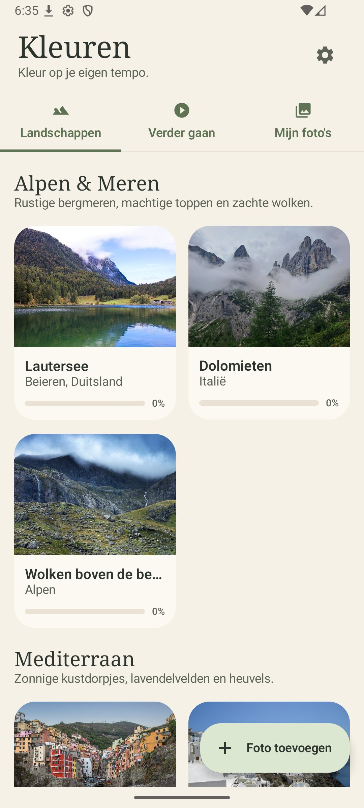
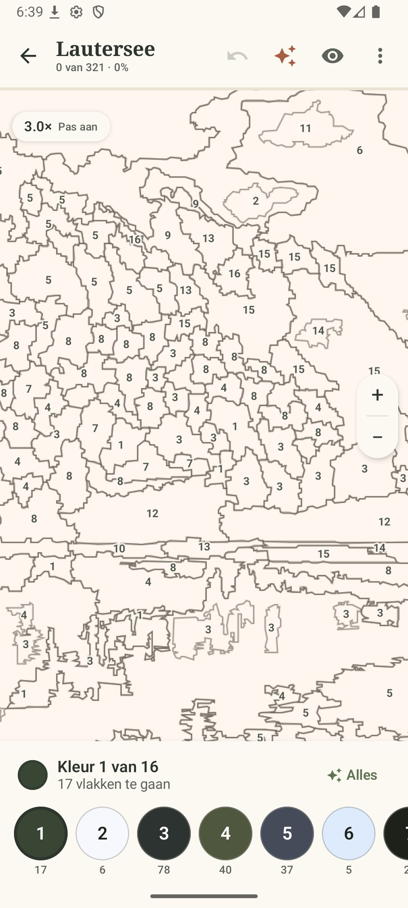
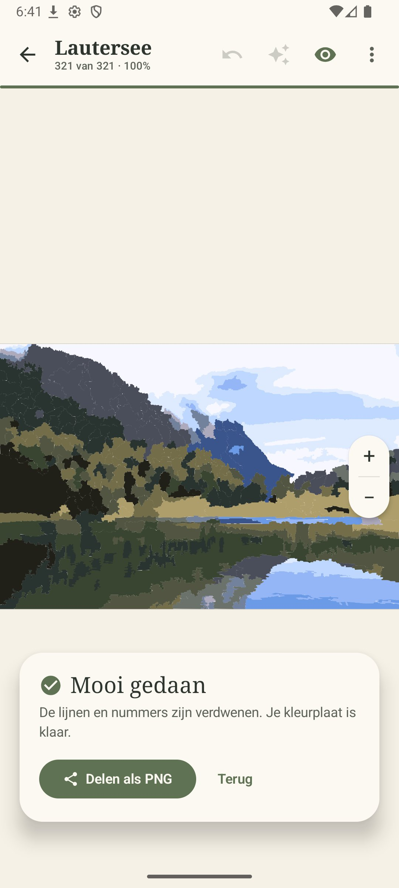
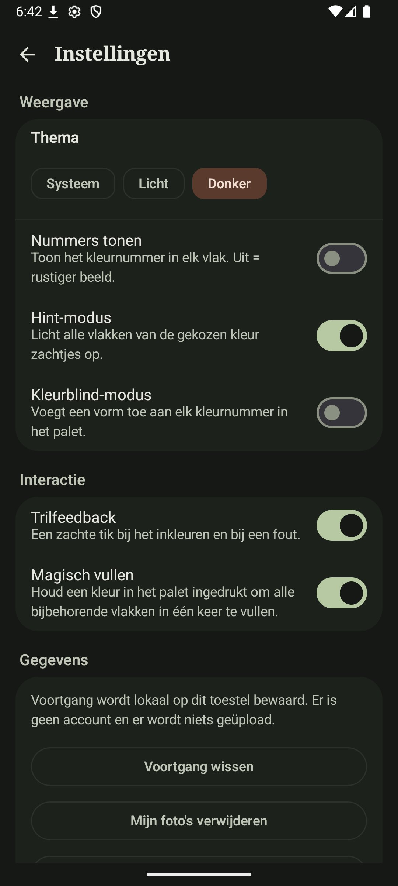

# Kleuren

Een rustige **paint-by-numbers-app** voor Android, gebouwd met Kotlin en Jetpack Compose.
Je kiest een Europees landschap (of je eigen foto), ziet een plaat met genummerde
vlakken en kleurt die op je eigen tempo in. Geen timer, geen levens, geen energie.

Deze repository is een leerproject: de code is bewust rechttoe-rechtaan gehouden en
voorzien van Nederlandse uitleg in de comments. Zo kun je als beginnend Android-
developer zien hoe een complete app in elkaar zit: van binaire bestandsformaten en
fotosegmentatie tot Compose-UI, Canvas-rendering en opslag.

| Bibliotheek | Kleurbord | Voltooid |
|---|---|---|
|  |  |  |

## Wat is er gebouwd?

- **10 meegeleverde landschappen** in 3 packs: *Alpen & Meren*, *Mediterraan* en
  *Noord & West*. Alle bronfoto's zijn CC0 (publiek domein).
- **Kleurbord** met:
  - pinch-zoom, pannen, zoomknoppen en "pas aan";
  - tikken om een vlak te vullen (alleen de juiste kleur, met vriendelijke feedback);
  - hint-modus die alle vlakken van de gekozen kleur oplicht;
  - magisch vullen (alle vlakken van één kleur in één keer, met één undo-actie);
  - onbeperkt undo binnen de sessie;
  - automatisch opslaan na elke actie;
  - rustige reveal-animatie bij voltooiing en delen als PNG.
- **Eigen foto's**: Photo Picker → voorbeeld → kleuraantal kiezen → genereren op het
  toestel → de plaat verschijnt onder "Mijn foto's". Geen upload, geen toestemmingen.
- **Bibliotheek** met drie tabbladen: Landschappen, Verder gaan en Mijn foto's.
  Voortgang en voltooiing zijn direct zichtbaar.
- **Instellingen**: nummers aan/uit, hint-modus, kleurblind-modus, haptics,
  magisch vullen, licht/donker/systeemthema en gegevens wissen.
- **Tests**: unit tests voor het bestandsformaat en de pijplijn, een content-QA-test
  over alle meegeleverde platen, en instrumented Compose-tests (o.a. pinch-zoom).
- **Offline generator-CLI** die exact dezelfde pijplijn gebruikt als de app.

### Status ten opzichte van `plan.md`

| Fase | Status |
|---|---|
| 0 – Setup | ✅ Gradle, Compose, thema, CI-workflow |
| 1 – Render-prototype | ✅ decoder, Canvas-engine, bitmaplagen, zoom/pan, vullen, undo |
| 2 – Pijplijn + content | ✅ generator-CLI, 10 platen, QA-test |
| 3 – App-UI | ✅ bibliotheek, voortgang, instellingen, voltooien/delen, hints |
| 4 – Eigen foto's | ✅ on-device segmentatie + Photo Picker |
| 5 – Polish | 🟡 thema's, haptics, kleurblind-modus, reveal; geluid/onboarding nog niet |
| 6 – Optimalisatie/release | ⬜ Perfetto op A54, Play Console, privacybeleid |

### Plan-onderdelen en waar ze staan

| Plan | In deze repo |
|---|---|
| 3.1 vaste moeilijkheid | `ConvertOptions` (12–20 kleuren, streefband 300–800, kleine vlakken samenvoegen) |
| 3.2 plaatformaat | `format/` + [docs/FORMAT.md](docs/FORMAT.md); id-map voor hit-testing; preview-JPEG |
| 4 segmentatiepijplijn | `pipeline/`: downscalen, smoothing, k-means, kleine vlakken mergen, contouren + DP |
| 5.1 bibliotheek | `ui/library/`: packs, Verder gaan, Mijn foto's, voortgang, verwijderen |
| 5.2 kleurbord | `ui/board/`: zoom/pan, palet, hint, magisch vullen, undo, autosave, reveal, delen |
| 5.3 foto toevoegen | `ui/photo/`: Photo Picker + on-device pipeline + voortgang/annuleren |
| 5.4 instellingen | `ui/settings/`: nummers, hints, kleurblind, haptics, thema, data wissen |
| 6 performance | bitmaplagen, dirty rects, id-map, nummer-culling, LRU-caches; tiled zoom is next |
| 7 content | 10 CC0-landschappen in 3 packs; bronnen en credits in `content/` |
| 8 mijlpalen | fasen 0–4 afgerond, fase 5 grotendeels |
| 9 tests | format-unit tests, pipeline-tests, content-QA, Compose instrumented tests |
| 10 risico's | kleine vlakken/thin regions, geheugenbudget, achtergrondwerk afgedekt; A54-meting open |

Het donkere thema is volledig uitgewerkt; het canvas blijft bewust licht zodat
kleuren uit de foto betrouwbaar blijven.



## Snel starten

### Vereisten

- Android Studio (recente versie) of de Android SDK + JDK 17/21.
- Een Android-toestel of emulator met **Android 8.0 (API 26)** of hoger.

### Android Studio

1. Open de map van dit project.
2. Wacht tot Gradle klaar is.
3. Kies een emulator/toestel en druk op **Run**.

De meegeleverde platen zitten al in `app/src/main/assets/`, dus je hoeft eerst
niets te genereren.

### Vanaf de command line

```bash
export ANDROID_HOME="$HOME/Android/Sdk"     # pas aan indien nodig
./gradlew :app:assembleDebug
adb install -r app/build/outputs/apk/debug/app-debug.apk
adb shell am start -n nl.kleuren.app/.MainActivity
```

### Tests

```bash
# Pure Kotlin: bestandsformaat en fotopijplijn
./gradlew :format:test :pipeline:test

# App-unit tests, inclusief QA over alle meegeleverde .kplate-bestanden
./gradlew :app:testDebugUnitTest

# Instrumented tests op een draaiende emulator/toestel
./gradlew :app:connectedDebugAndroidTest
```

## Projectstructuur

```
app/                     De Android-app (Compose, ViewModels, repos)
  src/main/assets/       manifest.json, .kplate-bestanden en previews
  src/main/java/nl/kleuren/app/
    data/                Room-loze opslag, manifest, instellingen
    ui/board/            bord-UI, renderer, zoom/pan, delen
    ui/library/          bibliotheek en voortgang
    ui/photo/            foto importeren en genereren
    ui/settings/         instellingen
    ui/theme/            kleuren, typografie, Material 3-thema
format/                  .kplate encoder/decoder (pure Kotlin, unit tested)
pipeline/                foto -> kleurplaat (pure Kotlin, unit tested)
tools/generator/         desktop-CLI om content te maken
content/                 bronfoto's, content.json en CREDITS.md
docs/                    screenshots en formaatdocumentatie
```

De modules `:format` en `:pipeline` hebben **geen Android-afhankelijkheden**. Daardoor
kun je ze razendsnel testen op je laptop en gebruikt de generator exact dezelfde
code als de telefoon. Dat is de belangrijkste architectuurkeuze van dit project.

## Hoe werkt het?

### 1. Het `.kplate`-formaat

Een plaat is één binair bestand met:

- een header (magie `KPLT`, versie, afmetingen, aantallen);
- een palet van 12–20 ARGB-kleuren;
- per regio: id, kleurindex, een vereenvoudigd vectorpad, zwaartepunt en oppervlakte;
- een **id-map**: per pixel welk regio-id daar ligt (voor O(1) hit-testing);
- een kleine preview-JPEG voor de bibliotheek.

De payload wordt met zlib gecomprimeerd. Een plaat is daardoor ongeveer 150–250 KB.
De volledige specificatie staat in [docs/FORMAT.md](docs/FORMAT.md) en in
`format/src/main/kotlin/nl/kleuren/format/PlateCodec.kt`.

### 2. Foto → kleurplaat

De pijplijn in `:pipeline` doet het volgende:

1. **Verkleinen** naar maximaal 1200 px (box filter, verhouding behouden).
2. **Ruis dempen** met een lichte edge-preserving filter.
3. **Kleuren kwantiseren** met k-means (12–20 kleuren) en bijna-identieke kleuren
   samenvoegen (Delta E).
4. **Labelmap gladstrijken** met een 3×3 mode-filter: minder spikkels, rustiger vlakken.
5. **Connected components** per kleur; kleine of te dunne vlakken samenvoegen met de
   buur met de langste gedeelde rand.
6. **Contouren** traceren langs de pixelanden en vereenvoudigen met Douglas–Peucker.
7. **Plaat opbouwen** met id-map en compact palet.

De generator en de app gebruiken dezelfde stappen en dezelfde standaardparameters,
zodat de moeilijkheid consistent is. De generator probeert bij content maximaal drie
keer met meer kleuren om binnen de region-bandbreedte te landen; de app doet twee
pogingen om de wachttijd kort te houden.

### 3. Het bord

- De ingekleurde vlakken en de lijnen worden naar **twee bitmaplagen** getekend.
  Elk frame toont alleen die twee bitmaps plus de dynamische laag (nummers, hint).
- Bij een tik wordt alleen het **dirty rect** rond het gevulde vlak opnieuw getekend.
  Alle gevulde regio's die dat gebied raken worden in de juiste volgorde hertekend,
  zodat details in een grote achtergrondregio niet verdwijnen.
- Hit-testing gaat via de id-map, niet via `Path.contains` per regio.
- Nummers worden dynamisch getekend met een minimale schermoppervlakte en
  onderlinge afstand. Bij uitzoomen verdwijnen onleesbare nummers; bij inzoomen
  komen ze terug. Zo blijft het beeld rustig en snel.
- Bij voltooiing faden lijnen en nummers weg; de voltooide plaat wordt als PNG
  gedeeld via een `FileProvider`.

### 4. Opslag

Voortgang is per plaat een klein binair bestandje (`files/progress/<id>.bin`) met
alleen de gevulde regio-ids. Eigen foto's staan in `files/myplates/` met een
`index.json`. Instellingen staan in `SharedPreferences`.

Het plan noemde Room en DataStore. Voor deze hoeveelheid data is dat overkill:
het zou code-generatie (KSP) en extra afhankelijkheden toevoegen zonder voordeel.
De repositories zijn zo opgezet dat je ze later kunt vervangen zonder de UI te wijzigen.

## Content genereren

De bronfoto's en configuratie staan in `content/`. Pas `content/content.json` aan en
draai:

```bash
./gradlew :tools:generator:run --args="content/content.json app/src/main/assets"
```

De generator schrijft:

- `app/src/main/assets/plates/<id>.kplate`
- `app/src/main/assets/previews/<id>.jpg`
- `app/src/main/assets/plates/manifest.json`
- `content/CREDITS.md`

Instellingen per plaat: `colors` (12–20), `title`, `subtitle`, `source`, `credit`,
`license` en `sourceUrl`. De generator print het aantal vlakken en waarschuwt als
een plaat buiten de streefband valt.

### Moeilijkheid tunen

In `pipeline/src/main/kotlin/nl/kleuren/pipeline/ConvertOptions.kt`:

| Parameter | Effect |
|---|---|
| `colorCount` | meer kleuren = meer detail en meer werk |
| `minRegionFraction` | grotere waarde = minder kleine vlakjes (standaard 0,04%) |
| `targetMinRegions` / `targetMaxRegions` | streefband voor het aantal vlakken |
| `simplifyEpsilon` | hoger = vloeiendere, minder jagende contouren |
| `maxSide` | lagere waarde = grover en sneller |

De huidige content heeft 240–591 vlakken en 13–20 kleuren per plaat. Drie platen
zitten iets onder de plan-bandbreedte van 300 doordat ze grote egale luchten/zeeën
hebben; dat is bewust geaccepteerd ten gunste van grote, goed aanraakbare vlakken.
De QA-test bewaakt minimaal 220 vlakken en 12–20 kleuren.

## Performance

Ontworpen volgens het plan:

- alleen dirty rects bij het vullen;
- id-map voor hit-testing;
- bitmaplagen in RGB_565/ARGB;
- generatie op `Dispatchers.Default`, nooit op de main-thread;
- previews en platen in LRU-caches.

Gemeten op de **emulator** `medium_phone` (1080×2400, geen A54): het geopende bord
gebruikt ongeveer **89 MB PSS** en de debug-APK is **16 MB** (release zonder signing:
**11 MB**, inclusief 2,4 MB content).
De echte performancegate (p95 < 16 ms op een Galaxy A54) moet nog met Perfetto op
hardware worden gemeten. Het wijzigen van de fill-bitmap kost bij een tik een
texture-upload; als dat op de A54 te veel jank geeft, zijn de voorbereide
vervolgstappen: lagere bitmapresolutie, getegelde lagen of de filled regions als
vector-overlay tekenen.

## Belangrijke keuzes en afwijkingen

- **Geen Room/DataStore**: kleine binaire bestanden + SharedPreferences (zie boven).
- **Eigen navigatiestack** in plaats van Navigation Compose: vier schermen, minder
  afhankelijkheden en je ziet precies wat "terug" doet. Voor grotere apps is
  Navigation Compose de logische volgende stap.
- **Geen geluid/achtergrondmuziek** in deze versie; haptics zijn wel geïmplementeerd.
- **Content**: 10 in plaats van 12–15 platen. De bronfoto's zijn CC0 en lokaal
  meegeleverd; downloadbare packs zijn een logische volgende fase.
- **Kaartvoorbeeld**: de thumbnail is de originele foto, niet een voorbeeld van de
  uiteindelijke kleurplaat. Een "preview van de plaat" kan later door de generator
  worden gerenderd.
- **Canvas blijft licht in donker thema**: kleuren uit de foto blijven zo betrouwbaar
  en de plaat is beter leesbaar. De app-UI wisselt wel van thema.
- **Taal**: de UI en de comments zijn Nederlands. Voor publicatie is het verstandig
  teksten naar `strings.xml` te verplaatsen en Engels toe te voegen.

## Volgende stappen

1. Perfetto-meting op de A54 en zo nodig de bitmap-/tile-strategie bijstellen.
2. Room/DataStore introduceren als de data groeit (meerdere weken geschiedenis,
   statistieken).
3. Navigation Compose en schermgebonden ViewModels.
4. Geluid, onboarding en een "plaat bijna klaar"-melding.
5. Remote pack-manifest + download, zodat de APK klein blijft.
6. Preview van de kleurplaat op de bibliotheekkaarten.
7. Play Console: closed test, privacybeleid, release-build met R8.
8. UI-teksten naar resources en eventueel Engelse vertaling.

## Licenties

- **App-code**: MIT-licentie, zie [LICENSE](LICENSE).
- **Fotocredits**: zie [content/CREDITS.md](content/CREDITS.md). Alle bronfoto's zijn
  CC0 (publiek domein), gedownload via Wikimedia Commons. De gegenereerde kleurplaten
  zijn afgeleide werken van die foto's.
- **Lettertypen**: systeemlettertypen van Android (geen gebundelde fonts).

## CI

De kant-en-klare GitHub Actions-workflow staat in
[`docs/ci-android.yml`](docs/ci-android.yml). Hij draait:

- unit tests van `:format` en `:pipeline`;
- app-unit tests (inclusief content-QA);
- `:app:assembleDebug` en upload van de APK als artifact.

De workflow is nog niet actief in deze repository, omdat de gebruikte
GitHub-token geen `workflow`-scope had. Activeren kan zo:

```bash
mkdir -p .github/workflows
cp docs/ci-android.yml .github/workflows/android.yml
gh auth refresh -s workflow
git add .github/workflows/android.yml
git commit -m "CI-workflow activeren"
git push
```

Instrumented tests draaien niet in CI, omdat daar een emulator met hardware-
versnelling voor nodig is. Lokaal:

```bash
./gradlew :app:connectedDebugAndroidTest
```
